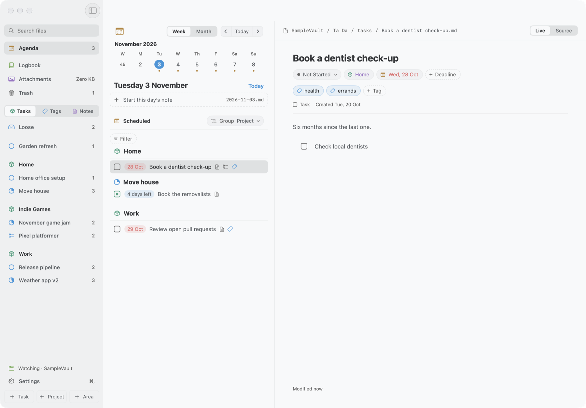
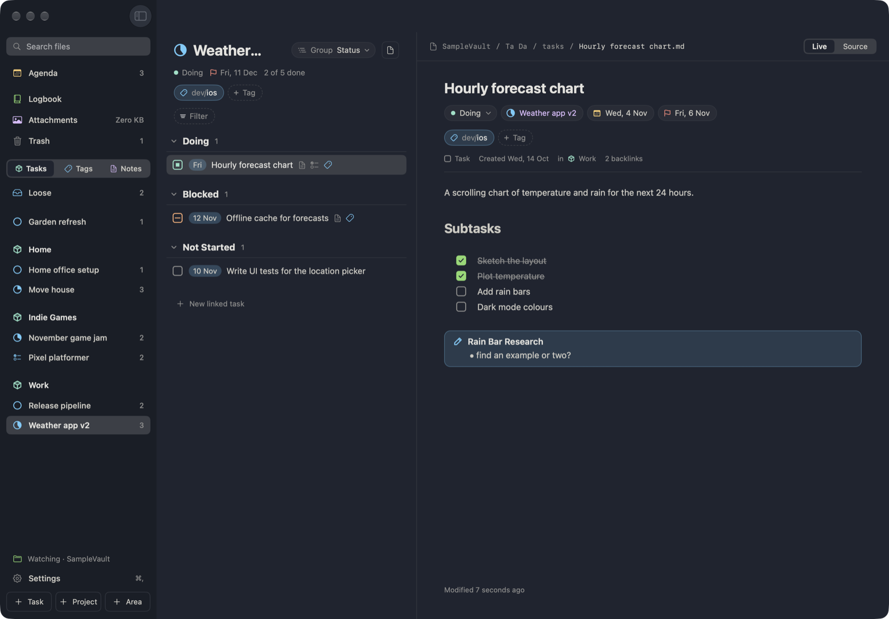
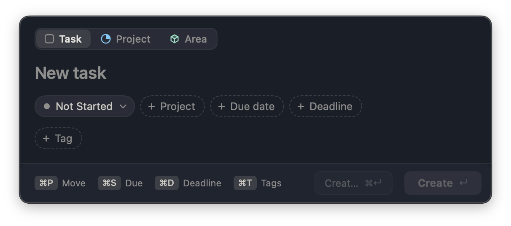
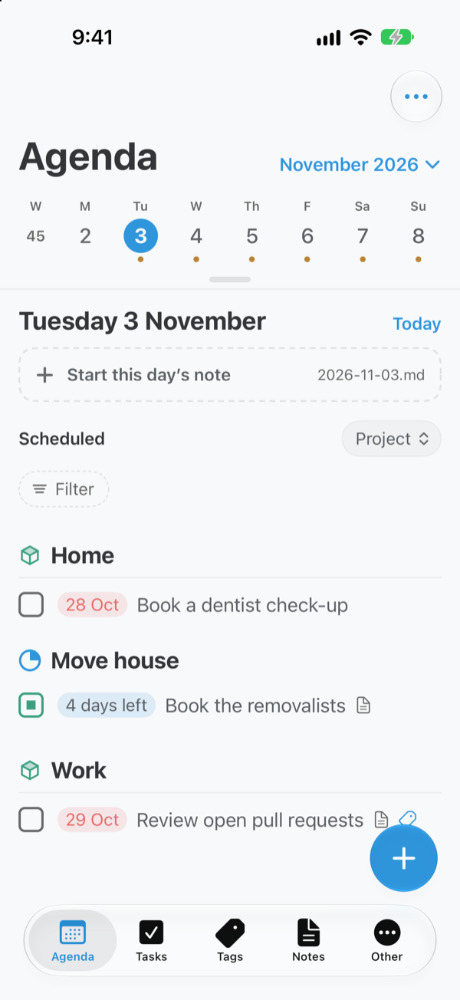
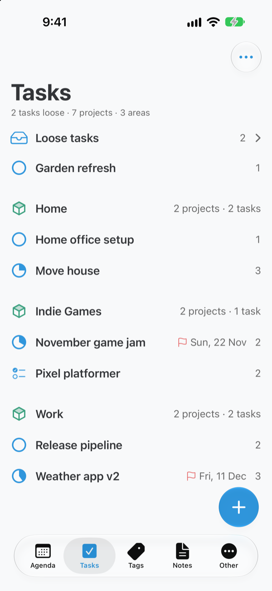
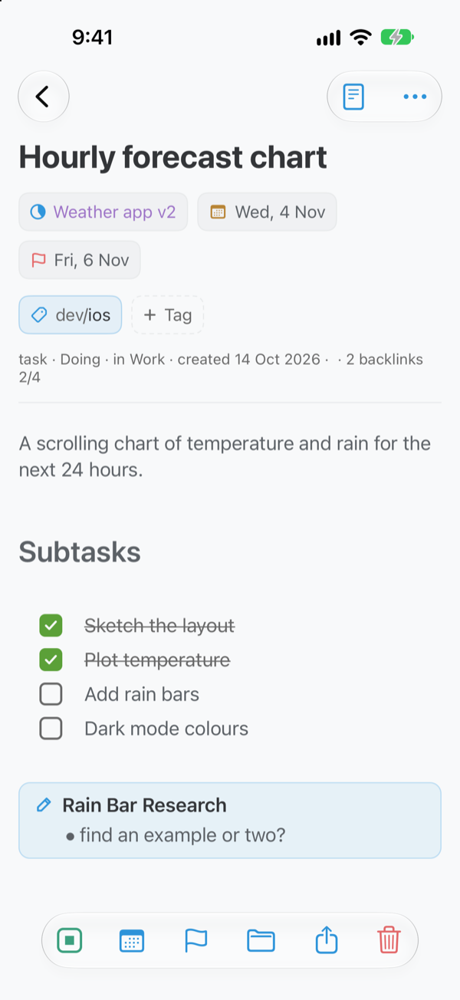
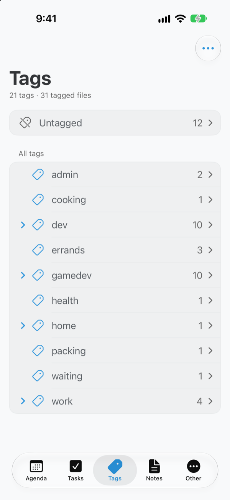

# Ta Da

A task manager over a folder of markdown files. Each task, project, area and note is one `.md` file with YAML frontmatter, so the folder stays readable in any text editor and works as an Obsidian vault.

<picture>
  <source media="(prefers-color-scheme: dark)" srcset="docs/images/mac-agenda-dark.png">
  
</picture>

## Apps

| | Status |
|---|---|
| **Mac** | Beta - signing and notarisation pending. |
| **iPhone** | Beta - App Store pending. |
| **Obsidian** | A plugin that can be used over the same vault: [ta-da-obsidian](https://github.com/lobrenov/ta-da-obsidian). |

All three read and write the same files, so any file-synced vault accessible by Ta Da and Obsidian works - e.g. iCloud Drive.

## What it does
- **Agenda**: a day's or a week's tasks under a week or month strip, with the daily or week note, calendar events and reminders.
- **Tasks, Tags and Notes**: areas with their projects, Loose tasks, the tag tree and the folder tree, each beside the open file.
- **Live editor**: markdown drawn as you type, with checkboxes, callouts, tables, embeds and `[[links]]`.
- **Quick Entry**: a global hotkey (⌃Space) opens a panel for a new task over any app.
- **Repeating tasks**, the **Logbook** for completed work, **Attachments** and **themes** (Ayu, TokyoNight and Catppuccin, light and dark).

<p>
  
  
</p>

<p>
  
  
  
  
</p>

## Install (Mac)
Requires macOS 26 or later.
1. Download the latest `.dmg` from [Releases](https://github.com/lobrenov/ta-da-app/releases), open it and drag **Ta Da** onto **Applications**.
2. Open Ta Da and click **Done** on the warning. Then open System Settings › Privacy & Security, click **Open Anyway** next to the Ta Da message, and confirm.
3. Choose your folder.

## Files
Ta Da keeps what it makes in `Ta Da/` at the top of the folder (`tasks/`, `projects/`, `areas/`, `logbook/`, `attachments/`) and reads typed files anywhere in it. Other markdown files are notes. It edits files by changing only the lines it needs, never rewriting the frontmatter or body. The format is in [`docs/file-format.md`](docs/file-format.md).

```markdown
---
type: task
status: Doing
project: "[[Ta Da MVP]]"
dueDate: 2026-10-02
repeat: every week on Fri
---
Bring the project instruction files in line with how I actually work now.
```

## Building
Xcode 27 on macOS 26 or later. Open `TaDa.xcworkspace` and run the TaDa scheme for My Mac or an iPhone. `SampleVault/` is a folder to point it at.

- Core tests: `swift test --package-path Packages/TaDaCore`
- App and core tests: `xcodebuild -workspace TaDa.xcworkspace -scheme TaDa -destination 'platform=macOS' test -skip-testing:TaDaUITests`

[`docs/architecture.md`](docs/architecture.md) describes the layers and files, and [`CLAUDE.md`](CLAUDE.md) the commands and conventions.

## Licence
MIT ([`LICENSE`](LICENSE)). The Live editor is [swift-markdown-engine-extended](https://github.com/lobrenov/swift-markdown-engine-extended), a fork of swift-markdown-engine under Apache-2.0. Third-party notices: [`TaDa/Acknowledgements.txt`](TaDa/Acknowledgements.txt).
